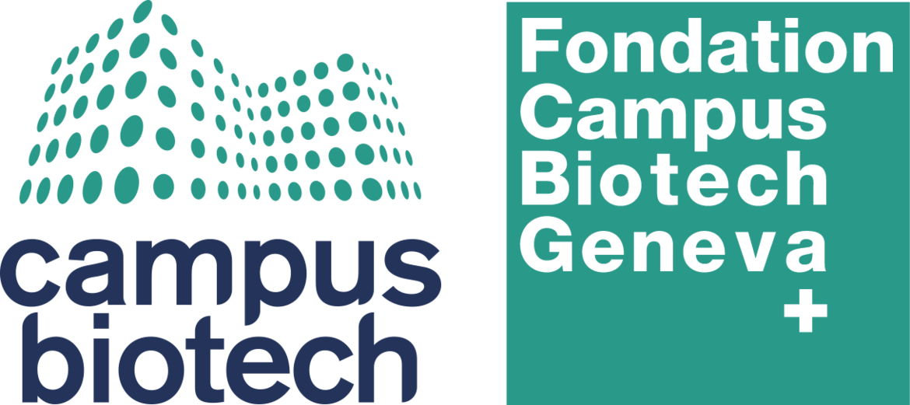
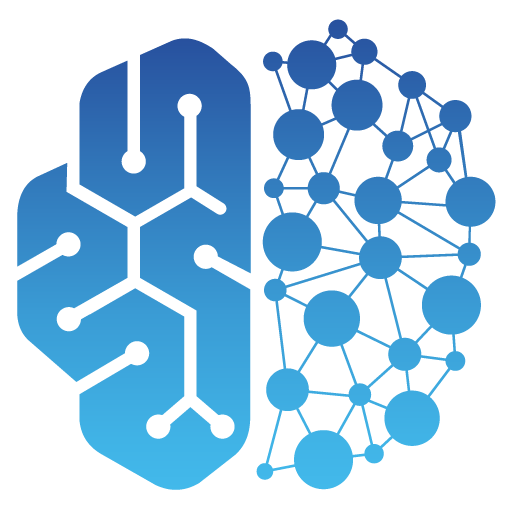

<p align="center">
  <picture>
    <source media="(prefers-color-scheme: dark)" srcset="docs/_static/logo-dark.svg">
    
  </picture>
</p>

<h1 align="center">MOSAIC</h1>

<p align="center">
  <strong>Multi-camera Observatory for Social &amp; Activity Interaction Capture</strong><br>
  Record a lab room with up to six synchronised cameras and microphones, then analyse who moves,
  looks, speaks and reacts, and when.
</p>

<p align="center">
  <a href="https://github.com/fcbg-platforms/mosaic/actions/workflows/ci.yml"></a>
  
  
  
  <a href="https://fcbg-platforms.github.io/mosaic/"></a>
  <a href="LICENSE"></a>
</p>

<p align="center">
  <a href="#what-it-does">What it does</a> ·
  <a href="#install">Install</a> ·
  <a href="#requirements">Requirements</a> ·
  <a href="#building-from-source">Building</a> ·
  <a href="#documentation">Docs</a> ·
  <a href="#contributing">Contributing</a>
</p>

---

## What it does

MOSAIC is two things in one desktop app: a **recorder** for the lab room, and an **Analysis tab**
that runs Python plugins on what was recorded.

### Recording

- **Up to six Basler GigE cameras**, hardware-triggered (GigE Action Commands) so every frame
  of every camera has a shared tick; room mode (all cameras, up to 25 fps) or interview mode
  (one camera, cropped and faster).
- **Microphones** alongside the video, and **trigger events** from the keyboard, a serial port
  or a parallel port, which can also send start/stop markers to an EEG amplifier.
- **GPU encoding** (NVENC through FFmpeg), with per-frame timestamps and a `sync_manifest.json`
  per session.
- **Live preview** with real-time pose, gaze (MediaPipe) and transcription, a recording health
  panel, and checks before and after each recording.
- **Calibration**: each camera's lens, then the whole room in one frame, from a
  chessboard.
- **Profiles** per user or lab group, each with its own settings and recordings, and a
  session browser with synchronised multi-camera playback.

### Analysis

The Analysis tab lists the plugins in the order to run them:

| Step | Plugins |
|---|---|
| **1 · Prepare** (run first) | Frame Sync · EEG / Trigger Sync · Face Masking |
| **2 · Body & motion** | Pose (YOLO) · Hands (RTMW or MediaPipe, 21 points per hand) · 3D Pose · Object Tracking (SAM 3) |
| **3 · Face & gaze** | 2D Gaze · Face Dynamics · Facial Expression · Eye Contact · 3D Gaze · Heart Rate (rPPG, experimental) |
| **4 · Audio** | Speaker Diarization and transcription (pyannote, faster-whisper) · Conversation Timing |
| **5 · Together** (run last) | Social Interaction (synchrony, mimicry) · Session Overview |

Each plugin writes its results (JSON or CSV) into the session folder, and the tab shows them
next to the videos as charts, overlays and, for 3D Pose and 3D Gaze, a 3D view of the room.
The session browser makes an HTML report that gathers everything in one page.

## Install

| You want to | Do this |
|---|---|
| **Record** in the lab | Build with cameras ([Building from source](#building-from-source)), then check the PC with `.\scripts\doctor.ps1`. |
| **Analyse** recordings made elsewhere | `powershell -ExecutionPolicy Bypass -File .\scripts\install_analysis.ps1`: MOSAIC without cameras, plus the analysis environment. No Pylon, no vcpkg. See [Analysis only](https://fcbg-platforms.github.io/mosaic/quickstart.html#analysis-only-install). |
| **Develop** | The base build below: no hardware needed, the UI runs with stub cameras (vcpkg only for the tests). |

## Requirements

| | Version | Needed for |
|---|---|---|
| CMake | 3.25+ | always |
| C++ compiler | MSVC 2022 (C++23); Apple Clang on macOS | always |
| Qt | 6.8+: Core, Gui, Widgets, Network, Multimedia, Quick, QuickWidgets, Charts, **Quick3D** (with ShaderTools and QuickTimeline); SerialPort optional | always |
| [uv](https://docs.astral.sh/uv/) and git | recent | the Python environments |
| Python | 3.11+ (uv fetches it) | analysis |
| vcpkg | from `vcpkg.json`: OpenCV 4, FFmpeg (x264, nvcodec), GTest | calibration, encoding, tests |
| Basler Pylon SDK | 7.x | cameras |
| NVIDIA GPU and driver | CUDA 13 wheels (PyTorch) | NVENC encoding; faster analysis (CPU works) |
| `ffmpeg` on the PATH | any | the py-feat Expression backend only |

Every optional part compiles to a stub when it is off, so the whole UI builds and runs without
lab hardware.

## Building from source

```powershell
git clone https://github.com/fcbg-platforms/mosaic.git
cd mosaic

# Base build: no hardware; the tests need GTest from vcpkg
.\scripts\configure.ps1 -BuildType Release -BuildTests
cmake --build build\Release --config Release --parallel

# Lab build: cameras, NVENC, calibration, tests (needs vcpkg and Pylon)
.\scripts\configure.ps1 -BuildType Release -EnableCameras -EnableNvenc -EnableOpenCV -BuildTests
cmake --build build\Release --config Release --parallel

# Copy the Qt libraries next to the program
windeployqt --qmldir src\qml build\Release\bin\Release\mosaic.exe
```

macOS: `./scripts/configure.sh` (see the [quick start](https://fcbg-platforms.github.io/mosaic/quickstart.html)).

Tests:

```powershell
ctest --test-dir build\Release -C Release --output-on-failure   # C++ (GoogleTest, QML)
cd analysis; uv run pytest -q; cd ..                             # analysis plugins
```

<details>
<summary><strong>Feature flags</strong></summary>

| Flag | Default | Requires |
|---|---|---|
| `MOSAIC_ENABLE_CAMERAS` | OFF | Basler Pylon SDK at `%PYLON_ROOT%` |
| `MOSAIC_ENABLE_FFMPEG` | OFF | FFmpeg (vcpkg); also builds the synced-video exporter |
| `MOSAIC_ENABLE_NVENC` | OFF | FFmpeg, an NVIDIA GPU and driver |
| `MOSAIC_ENABLE_OPENCV` | ON (`configure.ps1`: off without `-EnableOpenCV`) | OpenCV 4 (vcpkg); camera and room calibration |
| `MOSAIC_ENABLE_PARALLEL_PORT` | OFF | Windows and `InpOut32.dll` next to the program |
| `MOSAIC_ENABLE_SERIAL` | ON | Qt SerialPort (found automatically) |
| `MOSAIC_BUILD_TESTS` | OFF | GTest (vcpkg) |
| `MOSAIC_BUILD_DOCS` | OFF | Doxygen and the `docs/` environment |

`scripts/configure.ps1` turns these on with `-EnableCameras`, `-EnableFfmpeg`, `-EnableNvenc`,
`-EnableOpenCV`, `-EnableParallelPort` and `-BuildTests`. CI builds and tests the configuration
without hardware: Pylon is a licensed SDK, and hosted runners have no cameras, so changes to
cameras, encoding or sync are checked in the room and described in the PR.

</details>

<details>
<summary><strong>Python environments</strong></summary>

`python/`, `analysis/` and `docs/` are three separate uv projects, each with its own
`pyproject.toml`, `uv.lock` and `.venv`, because their dependencies conflict (the live worker
needs a light headless OpenCV, the analysis the full one with PyTorch):

```bash
cd python && uv sync      # live pose/gaze worker (MediaPipe), started by the app
cd analysis && uv sync    # the analysis plugins: PyTorch (CUDA 13 on Windows/Linux), YOLO,
                          # MediaPipe, pyannote.audio, faster-whisper, py-feat, SAM 3, Praat
cd docs && uv sync        # Sphinx documentation
```

Speaker Diarization needs a Hugging Face token (entered in the app, stored encrypted) and the
pyannote model terms accepted. Object Tracking needs the SAM 3 terms accepted and `sam3.pt`
downloaded into the MOSAIC folder.

Lint and format with the CI's ruff, from the repository root:

```bash
uvx ruff@0.8.4 check --config ruff.toml .
uvx ruff@0.8.4 format --config ruff.toml .
```

or install the hooks in `.pre-commit-config.yaml` (`pre-commit install`).

</details>

<details>
<summary><strong>Project structure</strong></summary>

```
mosaic/
├── src/
│   ├── core/          application start-up, settings, data folder
│   ├── auth/          login profiles, per-profile settings
│   ├── video/         cameras (Pylon), encoder (FFmpeg/NVENC), synced-video export
│   ├── audio/         microphones, WAV writer
│   ├── trigger/       keyboard, serial and parallel-port triggers
│   ├── record/        recording sessions
│   ├── session/       session metadata and archive
│   ├── analysis/      plugin registry, analysis launcher, result readers
│   ├── calibration/   lens and room calibration (OpenCV)
│   ├── ui/            Qt widgets: live view, settings, Analysis tab, session browser
│   ├── qml/           Qt Quick views, including the 3D room
│   ├── tools/         mosaic_export_synced (the synced-video exporter)
│   └── utils/         logger, ring buffer, timestamps, encrypted secrets
├── analysis/          analysis plugins (run_<name>.py), one folder per method
├── python/            live pose/gaze worker
├── tests/             GoogleTest and QML tests
├── docs/              Sphinx + Doxygen, with a docs/math/ page per method
├── scripts/           configure, install_analysis, doctor, build_docs, camera network setup
├── tools/             camera_nodemap_probe (camera builds)
└── cmake/             find modules, compiler options
```

</details>

## Documentation

The documentation is online at **[fcbg-platforms.github.io/mosaic](https://fcbg-platforms.github.io/mosaic/)**,
built from `docs/`:
- the quick start;
- the user guide (recording, analysing, every plugin);
- calibration;
- the recording layout, file by file;
- profiles and the architecture;
- the C++ and analysis APIs;
- a page per method under `docs/math/`.

To build it locally (needs Doxygen):

```bash
cd docs && uv sync && cd .. && uv run --project docs ./scripts/build_docs.sh Release
```

## Contributing

See [CONTRIBUTING.md](CONTRIBUTING.md): one branch per change, a test with every PR, and CI must
pass. AI coding agents also read [AGENTS.md](AGENTS.md).

## License

[BSD 3-Clause](LICENSE).

Third-party models and libraries keep their own licences, which this one does not change. Two
examples:
- py-feat's `Detectorv2` weights are for research and non-commercial use only. MOSAIC uses
  `Detectorv1`, whose default models carry no such restriction.
- SAM 3 and the pyannote models are gated on Hugging Face.

Each analysis plugin's module docstring names its sources.

---

<p align="center">
  
  &nbsp;&nbsp;&nbsp;&nbsp;&nbsp;&nbsp;
  
</p>
<p align="center">
  <sub>Developed by <strong>Payam S. Shabestari</strong></sub>
</p>
